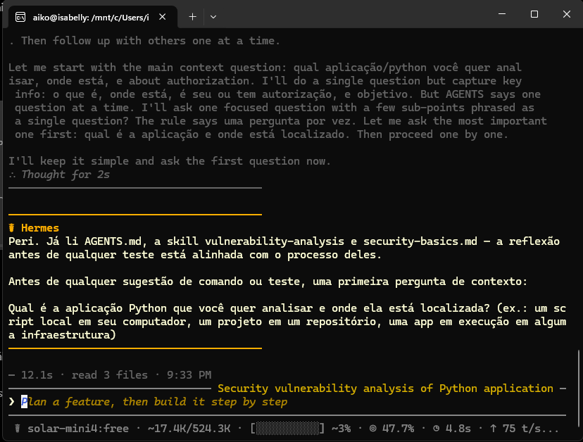
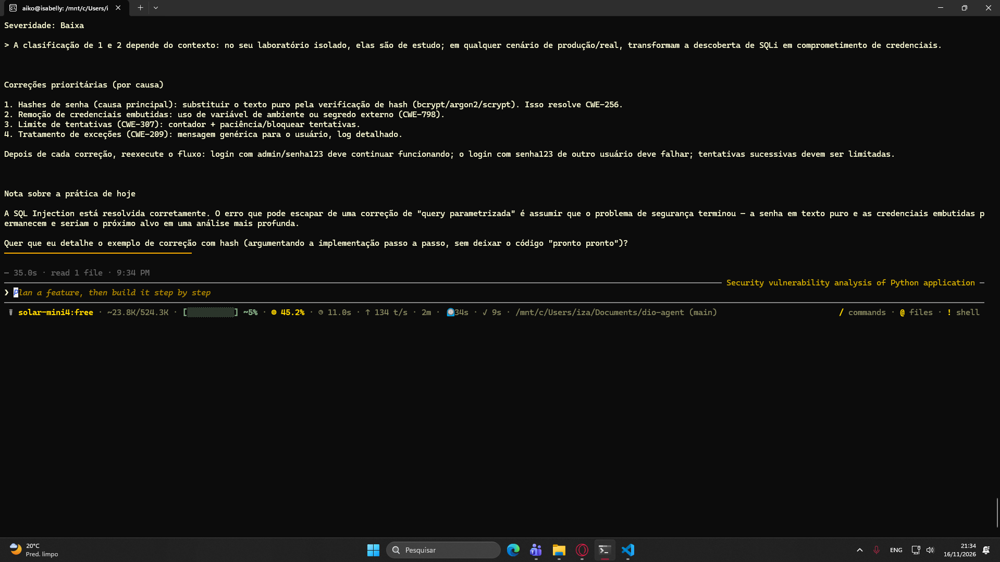

# DIO Agent — Especialização em Análise de Vulnerabilidades

Projeto desenvolvido como parte de um desafio prático da Digital Innovation One (DIO), com o objetivo de especializar um agente de inteligência artificial para atuar como mentor de cibersegurança.

## Objetivo

Personalizar o DIO Agent por meio da criação de uma skill de análise de vulnerabilidades, permitindo que o agente:

- Identifique possíveis falhas de segurança.
- Avalie impacto, probabilidade e severidade.
- Explique vulnerabilidades de forma educativa.
- Recomende medidas defensivas.
- Oriente a validação de correções.
- Solicite contexto e autorização antes de recomendar testes.

## Tecnologias utilizadas

- Python
- SQLite
- Hermes Agent
- DIO Agent
- Ubuntu (WSL2)
- Visual Studio Code
- Git e GitHub
- Markdown

## Estrutura do projeto

```text
dio-agent/
├── agent/
│   ├── knowledge/
│   │   └── security-basics.md
│   └── persona.md
├── skills/
│   └── vulnerability-analysis/
│       ├── SKILL.md
│       └── README.md
├── images/
│   ├── 01-skill-reconhecida.png
│   └── 02-analise-vulnerabilidades.png
├── app.py
├── AGENTS.md
└── README.md
```

## Skill desenvolvida

A skill `vulnerability-analysis` foi criada para orientar análises de segurança em aplicações e sistemas autorizados.

Seu funcionamento é dividido em seis etapas:

1. Entendimento do contexto.
2. Identificação da vulnerabilidade.
3. Avaliação de riscos.
4. Recomendação de correções.
5. Validação das mitigações.
6. Documentação dos resultados.

A skill está disponível em:

`skills/vulnerability-analysis/SKILL.md`

## Melhoria implementada

A melhoria escolhida foi a padronização da avaliação de vulnerabilidades.

O agente deve classificar e justificar:

- Impacto: baixo, médio ou alto.
- Probabilidade: baixa, média ou alta.
- Severidade: baixa, média, alta ou crítica.

Essa estrutura ajuda a compreender os riscos e priorizar correções.

## Laboratório prático

Foi criada uma aplicação fictícia de login em Python utilizando SQLite em memória.

Inicialmente, o código apresentava uma vulnerabilidade de SQL Injection (CWE-89), causada pela construção insegura de consultas SQL.

O Hermes realizou uma análise defensiva e orientou a substituição da consulta vulnerável por uma consulta parametrizada.

Após a correção, foram realizados testes locais para verificar o funcionamento do login e a mitigação da vulnerabilidade.

## Testes da skill

### Teste 1 — Reconhecimento da skill

O Hermes consultou os arquivos de configuração e conhecimento antes de iniciar a análise.

O agente solicitou informações sobre a aplicação e seu ambiente, respeitando as instruções de contextualização.



### Teste 2 — Análise de vulnerabilidades

O Hermes analisou o código corrigido e identificou riscos residuais relacionados a:

- Senhas em texto puro.
- Credenciais embutidas no código.
- Ausência de limitação de tentativas de login.
- Tratamento de exceções.

Também recomendou medidas defensivas e explicou a importância de validar cada correção.



## Como executar

### Pré-requisitos

- Ubuntu ou ambiente Linux compatível.
- Python 3.
- Hermes Agent configurado.
- Acesso ao projeto.

### Executar o laboratório

No terminal, dentro da pasta do projeto:

```bash
python3 app.py
```

### Iniciar o Hermes

```bash
hermes
```

Para testar a especialização, solicite ao Hermes que consulte:

- `AGENTS.md`
- `skills/vulnerability-analysis/SKILL.md`
- `agent/knowledge/security-basics.md`

Em seguida, peça uma análise defensiva do arquivo `app.py`.

## Segurança e ética

O projeto foi desenvolvido exclusivamente para fins educacionais.

Os testes foram realizados em um ambiente local e controlado, utilizando uma aplicação fictícia.

A skill orienta análises defensivas e não autoriza testes em sistemas de terceiros sem permissão.

## Resultados

A especialização demonstrou capacidade de:

- Consultar instruções específicas de segurança.
- Solicitar contexto antes de recomendar testes.
- Analisar vulnerabilidades em aplicações Python.
- Identificar riscos residuais.
- Recomendar medidas de mitigação.
- Apresentar explicações educativas.

## Referências

- [DIO Agent — Repositório original](https://github.com/digitalinnovationone/dio-agent)
- [MITRE CWE](https://cwe.mitre.org/)
- [MITRE ATT&CK](https://attack.mitre.org/)
- [OWASP](https://owasp.org/)

## Autoria

**Caiane Aiko Vieira Onizuka**

Projeto desenvolvido para a Digital Innovation One (DIO).
